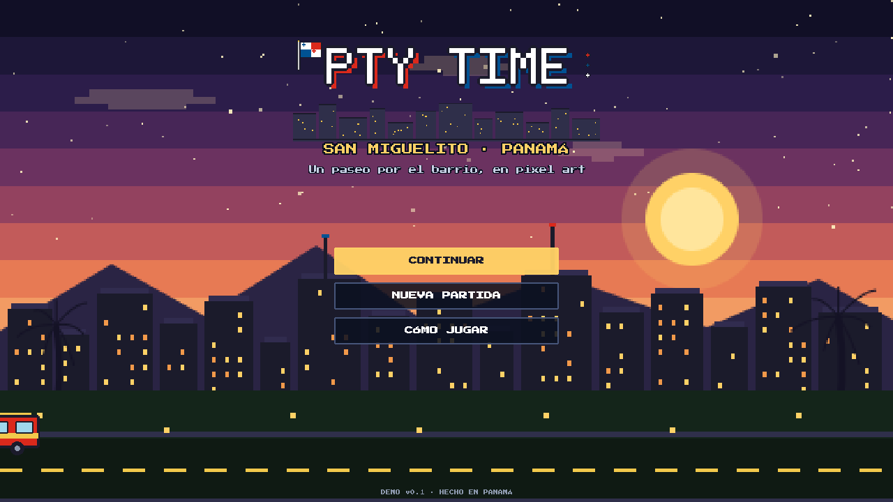
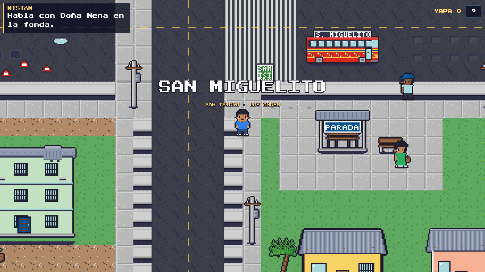
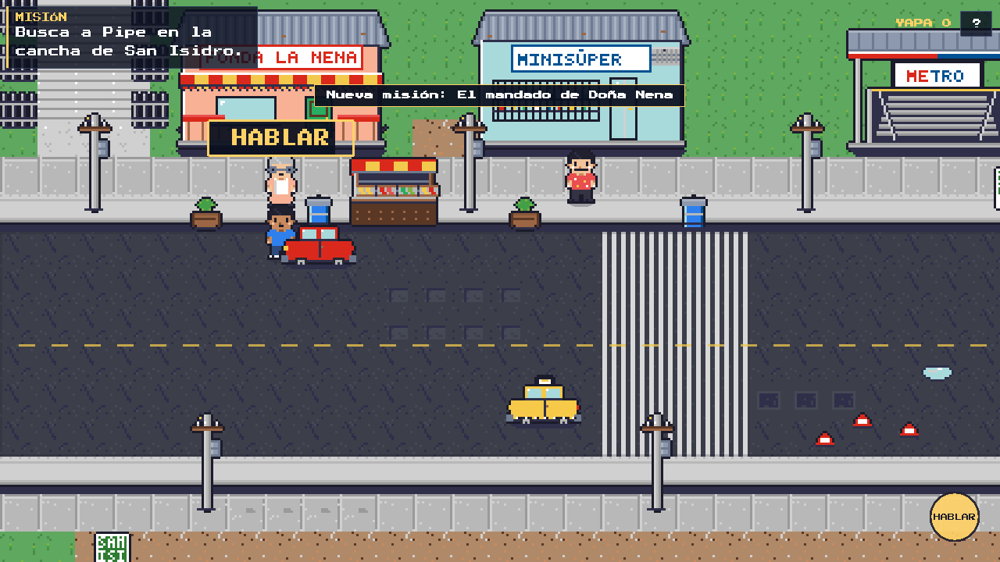
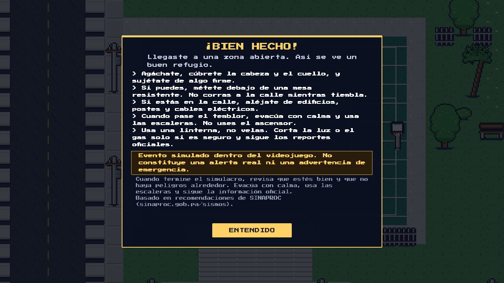
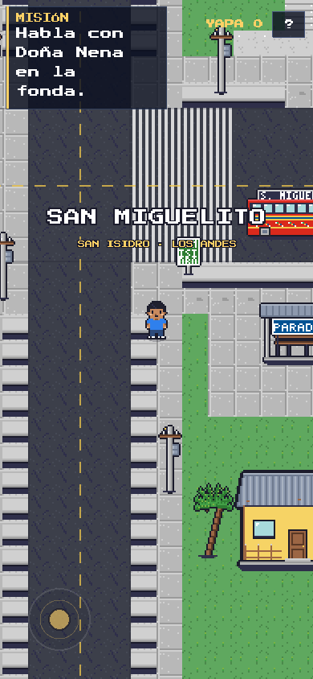

# PTY TIME

Videojuego panameño de **acción y supervivencia zombi** en pixel art 2D con cámara
cenital. Acompaña a **Calito**, un antihéroe de San Miguelito, desde la vida de barrio
hasta el apocalipsis. Pensado para correr en navegador, tanto en computadora como en
teléfono.

> **Nueva dirección creativa (v1.2):** PTY TIME pasa de aventura relajante de exploración
> a **aventura narrativa de supervivencia**, conservando Panamá, sus personajes y su
> identidad cultural. El documento de referencia es
> [`docs/MASTER_DOC.md`](docs/MASTER_DOC.md) y la auditoría de adaptación, con lo que ya
> existe y lo que falta, está en [`docs/V1.2_AUDIT.md`](docs/V1.2_AUDIT.md).

## Estado de la demo actual (v0.3.0 · Slice A cerrado)

La versión jugable ya incluye el **Slice A completo**:

- **Calito como protagonista**: identidad fija (muchacho de San Miguelito); la pantalla
  de personaje ahora solo permite elegir la camisa, que es cosmética.
- **Combate**: pistola «LA 9» con cargador, reserva, recarga y cadencia; puño como arma
  cuerpo a cuerpo; cambio de arma con `Q` o botón ARMA; balas, fogonazos, impactos y
  sacudida de cámara moderada.
- **Matones con IA**: 4 enemigos (matón y matón jefe) con estados idle → persecución →
  ataque, **línea de visión** (no ven a través de edificios), investigación de la última
  posición conocida y reacción a los disparos.
- **Vida y munición**: barra de vida, daño, modal de KO y reaparición; HUD integrado.
- **Misión criminal**: *Los matones de la plaza* (se abre al terminar el mandado):
  derriba a 3 matones y vuelve con Pipe para cobrar 60 de yapa y reputación.
- **Guardado v2** con vida, munición, yapa, reputación y estado de todas las misiones.
  Los guardados de la v0.1.0 se migran solos.
- **Controles táctiles** de combate: FUEGO (apunta al matón más cercano), R y ARMA.

Sigue la base anterior: mapa de San Miguelito, 8 NPCs con diálogos, mandado de Doña Nena,
simulacro de terremoto con PTY Alerta y guardado local.

> **Dirección visual:** el personaje se mueve en diagonal y apunta libre, pero las hojas
> de animación mantienen **4 filas visuales** (arriba/abajo/izquierda/derecha) con la
> dirección dominante. Es una decisión de producto tomada en la auditoría para no
> redibujar todo el arte; las diagonales quedan como mejora opcional futura.

> **Estado de publicación:** https://pty-time.vercel.app sirve todavía la **v0.1.0**.
> Esta v0.2.0 está verificada en local (52/52 pruebas, QA E2E) y lista para desplegar.

> **Evento sísmico:** el simulacro de terremoto es ficción dentro del videojuego. No es
> una alerta real, no se conecta a sistemas de monitoreo y no sustituye información
> oficial. Recomendaciones basadas en [SINAPROC](https://www.sinaproc.gob.pa/sismos/).







## Demo publicada

- **Jugar:** https://pty-time.vercel.app (v0.3.0)
- **Repositorio:** https://github.com/bampasspty/pty-time

Desplegada en Vercel (proyecto `pty-time`). Verificación automatizada contra la URL
pública: HTTP 200, 8/8 comprobaciones (`tools/qa-prod.mjs`), 0 errores de consola y
58 FPS en Edge headless con GPU.

## Estado

Demo jugable (Slice A cerrado). Incluye:

- Pantalla de inicio, ayuda y apariencia de Calito (camisa cosmética).
- **Calito** controlable, con animación de caminar y profundidad; movimiento diagonal.
- Mapa de San Miguelito de 64 × 44 tiles: avenida, calle Los Andes, aceras, escaleras,
  cancha, fonda, minisúper, metro, parada, escuela, casas y apartamentos.
- Colisiones con edificios, mobiliario y límites del mundo; cámara que sigue al jugador.
- 8 NPCs con diálogos propios y paseo ligero.
- Misión **El mandado de Doña Nena** con 5 pasos y recompensa.
- Misión criminal **Los matones de la plaza** con combatientes y recompensa.
- Combate cenital con pistola, puño, munición, recarga y enemigos con IA y línea de visión.
- Vida, daño, KO y reaparición; barra de vida y munición en el HUD.
- Guardado automático v2 en `localStorage` (migra partidas v1) y opción CONTINUAR.
- Simulacro de terremoto desbloqueable: cubrirse, sujetarse y evacuar a zona abierta,
  con advertencia visible y recomendaciones educativas.
- HUD de misión, yapa y combate; ayuda, controles táctiles y toasts.
- Assets de pixel art generados por código (65 PNG, 44.9 KB) y fuente Press Start 2P.

## Requisitos

- Node.js **20.19 o superior** (probado con Node 24.21).
- pnpm **11.x** (el repo fija `packageManager: pnpm@11.28.5`).
- Para regenerar arte: Python 3.12 + Pillow 12 (solo desarrollo).

## Ejecutar en local

```bash
pnpm install
pnpm dev
```

Abrir **http://localhost:5173/**.

```bash
pnpm build      # build de producción en dist/
pnpm preview    # sirve dist/ en http://localhost:4173/
pnpm test       # pruebas unitarias y de assets (node:test)
```

## Controles

| Acción | Computadora | Teléfono |
|---|---|---|
| Caminar | WASD o flechas | Joystick virtual (abajo-izquierda) |
| Apuntar | Ratón | Automático al matón más cercano |
| Disparar | Clic izquierdo o J | Botón FUEGO |
| Recargar | R | Botón R |
| Cambiar arma | Q | Botón ARMA |
| Hablar / recoger | E, ESPACIO, ENTER o botón HABLAR | Botón HABLAR |
| Agacharse / cubrirse | C o botón CUBRIRSE durante el simulacro | Botón CUBRIRSE |
| Ayuda | ? o ESC | Botón ? |
| Simulacro | Botón SIMULACRO (cuando está desbloqueado) | Botón SIMULACRO |

La estrella amarilla marca al NPC del objetivo actual. El HUD superior muestra la
misión, la vida, el arma con su munición y la yapa acumulada.

## Juego: misiones, combate y simulacro

### El mandado de Doña Nena

1. Habla con **Doña Nena** en la fonda para aceptar el mandado.
2. Busca a **Pipe** en la cancha de San Isidro.
3. Encuentra su **chancleta** cerca de la parada de bus.
4. Devuélvesela a Pipe y vuelve con Nena.
5. Nena te da **25 de yapa** y desbloquea el **simulacro de terremoto**.

### Los matones de la plaza (misión criminal)

1. Al terminar el mandado, **Pipe** te cuenta que unos matones cobran por la plaza de
   Los Andes.
2. Acepta la misión: los 4 matones aparecen en la plaza (esquina suroeste del mapa).
3. Tumba a **3** con la pistola o el puño; el HUD lleva la cuenta.
4. Vuelve con Pipe: **+60 de yapa** y **+10 de reputación** en el barrio.

Si te tumban, reapareces en el punto de partida con la vida completa.

Durante el simulacro el juego muestra el aviso:

> Evento simulado dentro del videojuego. No constituye una alerta real ni una advertencia
> de emergencia.

El simulacro pide agacharse/cubrirse, sujetarse y llegar a una zona abierta (cancha o
plaza). Al terminar se muestran recomendaciones basadas en SINAPROC (
[sinaproc.gob.pa/sismos](https://www.sinaproc.gob.pa/sismos/)). No hay predicción de
sismos ni alertas reales.

## Arquitectura

```
src/
├── main.js                 configuración de Phaser y arranque
├── config.js               constantes visuales, cámara, tipografía
├── scenes/
│   ├── BootScene.js        carga de assets, animaciones y texturas de combate
│   ├── TitleScene.js       pantalla de inicio
│   ├── CharacterScene.js   creación de personaje
│   ├── GameScene.js        mundo, jugador, NPCs, misiones, combate y simulacro
│   └── UIScene.js          HUD, diálogos, modales, controles táctiles
├── entities/               Player, NPC, Enemy, Bullet
├── systems/                MissionSystem, CombatSystem, EnemyAI, SaveSystem,
│                           QuakeDrill, EventBus, InputState
├── world/                  mapa de San Miguelito, defs y MapBuilder
├── ui/                     DialogueBox, Modal, PixelButton, Backdrop
└── data/                   NPCs, diálogos, misiones, armas, enemigos y simulacro
public/assets/              tiles, personajes, enemigos, edificios, props, UI y fuente
tools/generate_assets.py    generador de pixel art (Pillow)
tools/qa-final.mjs          QA E2E de la demo (misión, simulacro, móvil)
tools/qa-combat.mjs         QA E2E del Slice A (combate, misión criminal, KO)
tools/qa-prod.mjs           verificación de la URL pública de Vercel
tests/                      pruebas node:test (lógica, mapa, assets, combate, IA)
docs/                       contratos, documento maestro, auditoría, reporte de assets y QA
```

La lógica de juego pesada es pura y testeable, sin Phaser: `MissionSystem` (registro de
misiones), `CombatSystem` (vida, cargador, cadencia, recarga) y `EnemyAI` (máquina de
estados de los matones). `SaveSystem` guarda el esquema v2 y migra partidas v1. Los
diálogos se resuelven con `getDialogue(npcId, ctx)` y devuelven la acción de misión;
`GameScene` aplica el cambio, actualiza el HUD y guarda.

## Rendimiento

- Phaser 3.90 + Vite 7; bundle de producción ≈ 1.33 MB (≈ 370 KB gzip).
- Assets de juego: **44.9 KB** de 65 PNG.
- Un solo tilemap para el suelo; ~17 edificios, 147 props, 8 NPCs y 4 matones.
- Efectos de combate con texturas generadas en memoria y tweens cortos; sin partículas.
- QA automatizado en Edge headless con GPU: **51–59 FPS a 1280 × 720** y **50–57 FPS a
  844 × 390** con combate activo (ver `docs/QA_REPORT.md`). Falta validar en un teléfono
  físico de gama baja.
- Prueba automatizada en Edge headless con GPU: **50–57 FPS a 844 × 390** en el mapa
  completo (ver `docs/QA_REPORT.md`). Falta validar en un teléfono físico de gama baja.

## Publicación en Vercel

La demo está publicada en **https://pty-time.vercel.app** y el proyecto Vercel está
**conectado a GitHub**: cada push a `main` en
https://github.com/bampasspty/pty-time genera un deployment de producción automático.

`vercel.json` define Vite, `pnpm build`, salida `dist/` y cache de assets. Para volver a
desplegar desde este repo (requiere estar autenticado con una cuenta de Vercel):

```bash
pnpm deploy:vercel
# equivalente: pnpm exec vercel deploy --prod --yes --project pty-time
```

El proyecto quedó vinculado a la cuenta `gestion14`. Para publicar desde otra cuenta,
hay que crear un proyecto nuevo con `vercel login` y `vercel deploy --prod`.

Repositorio de código: **https://github.com/bampasspty/pty-time** (rama `main`).

## Assets y licencias

- Pixel art generado por `tools/generate_assets.py` (determinista) y revisado en
  `tools/asset_sheet.png`. Ver `docs/ASSETS_REPORT.md`.
- Fuente **Press Start 2P** (SIL Open Font License 1.1) en
  `public/assets/ui/PressStart2P-Regular.ttf`; licencia en `public/assets/ui/OFL.txt`.
- Sin assets de terceros con copyright.
- Información educativa del simulacro basada en SINAPROC:
  <https://www.sinaproc.gob.pa/sismos/>.

## Limitaciones conocidas

- Una sola zona jugable (San Miguelito). El Slice B (infección y zombis) aún no está.
- Las animaciones mantienen 4 filas visuales; el movimiento diagonal usa la dirección
  dominante (decisión de producto, ver `docs/V1.2_AUDIT.md` §6).
- Sin música ni efectos de sonido en esta entrega.
- El arte es programático y minimalista, no una reproducción real de calles.
- El simulacro es una simulación educativa, no una alerta ni un sistema de emergencia.
- Falta probar en hardware físico de gama baja; el objetivo es que funcione en móviles
  modernos con WebGL.
